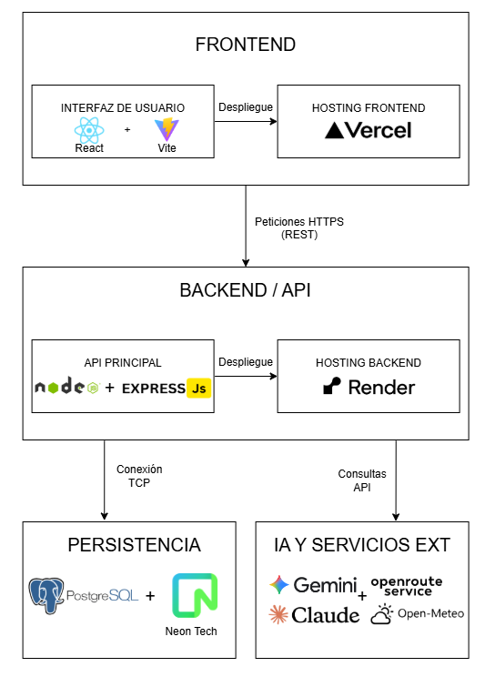

# RouteRobots

**Plataforma SaaS para la planificación y evaluación inteligente de rutas para robots autónomos de reparto.**

## Descripción

Los robots autónomos de reparto necesitan desplazarse por entornos urbanos donde la ruta más corta no siempre es la más conveniente. Factores como el estado de las veredas, las pendientes, las condiciones climáticas, los obstáculos y la autonomía de la batería pueden afectar la seguridad y viabilidad de un recorrido.

**RouteRobots** busca centralizar esta información en una plataforma que permita analizar rutas alternativas, identificar riesgos y recomendar recorridos considerando las características de cada robot.

La propuesta también contempla un sistema colaborativo donde los robots de una flota puedan reportar incidentes durante sus recorridos, esta información se compartiría con los demás robots, permitiendo actualizar las condiciones conocidas de las calles y prevenir problemas antes de iniciar nuevas entregas.

El objetivo no es reemplazar los sistemas de navegación autónoma de cada robot, sino proporcionar información preventiva y herramientas de apoyo para la planificación y supervisión de sus recorridos.

## Enfoque tecnológico

RouteRobots combina servicios geográficos, algoritmos de evaluación e inteligencia artificial para analizar las condiciones de una ruta.

La arquitectura contempla dos mecanismos complementarios:

- **Evaluación mediante algoritmos:** cálculo de distancias, restricciones de circulación y penalizaciones por incidentes conocidos. Esta lógica puede ejecutarse mediante reglas verificables, sin depender de consultas constantes a modelos de IA.
- **Inteligencia artificial:** Mediante mcp Interpretar información, analiza situaciones y generar recomendaciones fundamentadas para el recorrido del robot.

La plataforma contempla tres posibles resultados para la evaluación de una ruta:

- **Apta:** el recorrido cumple con los criterios establecidos.
- **Apta con supervisión:** existen condiciones que requieren precauciones adicionales o intervención humana.
- **No recomendada:** el recorrido presenta riesgos elevados o restricciones que justifican seleccionar una alternativa.

Estos resultados deben interpretarse como recomendaciones de planificación, no como garantías de seguridad.

## Funcionalidades y evolución del proyecto

El desarrollo contempla las siguientes capacidades:

**Planificación y evaluación de rutas**
- Visualización de rutas alternativas sobre un mapa.
- Consulta de información geográfica y climática.
- Consideración de las características y limitaciones de cada robot.
- Evaluación de riesgos y condiciones del recorrido.

**Gestión colaborativa de incidentes**
- Registro de obstáculos, bloqueos y otras condiciones relevantes.
- Asociación de incidentes con segmentos de la red peatonal.
- Asignación de penalizaciones y restricciones de circulación.
- Actualización de la información disponible para los demás robots.
- Recomendación de rutas alternativas cuando las condiciones lo requieran.

**Planificación preventiva y supervisión**
- Generación de un plan de entrega con los riesgos conocidos de la ruta.
- Identificación de tramos que requieren precaución.
- Detección de situaciones que podrían requerir supervisión humana.
- Consideración de puntos de transición entre veredas, rampas y desniveles según las capacidades del robot.

Las funcionalidades se encuentran en distintas etapas de desarrollo. Las capacidades relacionadas con incidentes colaborativos, puntuación de segmentos, planes de entrega y supervisión forman parte de la evolución prevista del MVP y no deben interpretarse como completamente implementadas.

## Alcance del MVP

El proyecto se desarrolla como una plataforma de software, sin control directo de robots físicos.

Se utiliza **Washington D. C.** como entorno geográfico de referencia para realizar simulaciones y evaluaciones de rutas.

Los usuarios objetivo son empresas de reparto autónomo, operadores de flotas, universidades y centros de investigación.

La plataforma busca demostrar cómo la combinación de información geográfica, datos colaborativos e inteligencia artificial puede mejorar la planificación preventiva de recorridos.

## Stack tecnológico y justificación de las decisiones

| Componente        | Tecnología                     | Motivo de elección                                                                                                                          |
| ----------------- | ------------------------------ | ------------------------------------------------------------------------------------------------------------------------------------------- |
| Frontend          | React + TypeScript             | Elegí React para construir una interfaz con mapas, formularios y paneles que pudiera organizar en componentes.                              |
| Backend           | Node.js + Express + TypeScript | Opté por estas tecnologías para desarrollar la API y mantener TypeScript tanto en el frontend como en el backend.                           |
| Base de datos     | PostgreSQL (Neon)              | Preferí utilizar una base de datos relacional tradicional. Neon surgió como alternativa para alojarla sin administrar un servidor propio.   |
| Mapas             | OpenStreetMap                  | Busqué una fuente abierta de información geográfica para trabajar con las calles y veredas del entorno de simulación.                       |
| Rutas             | OpenRouteService               | Lo consideré para obtener recorridos sin tener que desarrollar desde cero un motor de cálculo de rutas.                                     |
| Clima             | Open-Meteo                     | Lo seleccioné como fuente de información meteorológica que pudiera incorporar a las evaluaciones.                                           |
| Integración de IA | MCP                            | Me interesó separar las herramientas que consultan información de la IA que las utiliza, para poder ampliar sus capacidades posteriormente. |
| Frontend Cloud    | Vercel                         | Lo elegí para publicar el frontend y aprovechar su integración con el repositorio de GitHub.                                                |
| Backend Cloud     | Render                         | Busqué una opción de despliegue accesible para mantener la API disponible sin administrar un servidor propio.                               |
| CI/CD             | GitHub Actions                 | Lo incorporé para ejecutar verificaciones automáticas desde GitHub y comprobar los cambios antes de integrarlos.                            |
| Observabilidad    | Sentry + logs                  | Lo contemplé para poder identificar errores y analizar problemas que aparezcan durante la ejecución.                                        |

La tabla recoge las tecnologías utilizadas o contempladas en la arquitectura. Su estado de integración se revisa durante la auditoría técnica.

## Despliegue

### Entornos

- **Frontend:** https://route-robots.vercel.app/
- **Backend — Health Check:** https://route-robots-api.onrender.com/api/health

El backend utiliza infraestructura gratuita de Render, por lo que puede experimentar demoras en la primera solicitud después de un período de inactividad.

### Arquitectura Cloud

## Documentación

- [`AI-DECISIONS.md`](./AI-DECISIONS.md): registro del uso de inteligencia artificial, decisiones y verificaciones.
- [`docs/AUDITORIA.md`](./docs/AUDITORIA.md): revisión técnica del sistema, verificaciones y correcciones.
- [`docs/Aprendizaje.md`](./docs/Aprendizaje.md): reflexiones y aprendizajes obtenidos durante el desarrollo.

El proyecto utiliza GitHub Issues y Projects para organizar tareas y criterios de aceptación, y GitHub Actions para ejecutar las verificaciones automatizadas configuradas.

## Estado del proyecto

RouteRobots se encuentra en desarrollo y mejora continua.

Actualmente se está realizando una auditoría técnica retrospectiva del código existente para verificar su funcionamiento, corregir posibles problemas y fortalecer la documentación y trazabilidad del desarrollo.

Una vez finalizada esta etapa, se continuará con las funcionalidades priorizadas para el MVP.